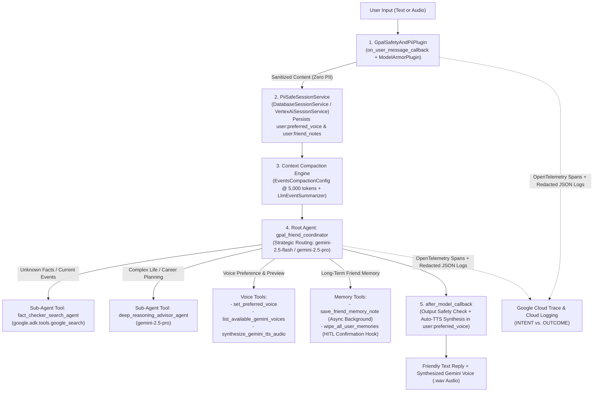

# GPAL ("Google Pal") — Empathetic Voice & Text Companion Agent (`adk-python`)

**GPAL ("Google Pal")** is a privacy-first, voice-and-text conversational friend built with the **Google Agent Development Kit (`google-adk`)** in Python. GPAL listens to the user via text or spoken audio inputs, responds warmly with natural synthesized speech using Google's latest **Gemini TTS** and **Gemini Live Native Audio** models, verifies facts using live **Google Search grounding**, remembers the user's chosen voice and personal milestones across sessions, compacts conversation context automatically at **5,000 tokens**, and scrubs sensitive PII via **Google Cloud Model Armor** and **Cloud Data Loss Prevention (SDP)** before any input is stored in memory or emitted to logs.

---

## 1. Problem & Solution

- **The Problem**: Conversational AI companions typically force an uncomfortable trade-off: either they are stateless voice assistants that forget who you are and reset your preferred voice every session, or they persist raw conversation histories containing unredacted Personal Identifiable Information (PII) while hallucinating answers to topical real-world questions.
- **The GPAL Solution**:
  1. **Natural Gemini Voice Synthesis & Live Audio**: Speaks to the user in their chosen prebuilt Gemini voice (`Puck`, `Kore`, `Charon`, `Aoede`, `Fenrir`, `Leda`, `Orus`, `Zephyr`) using `gemini-3.8-flash-lite-tts` / `gemini-3.8-flash-tts` (with automatic regional fallback to `gemini-2.5-flash-preview-tts` and raw PCM-to-WAV RIFF container normalization) as well as real-time bidirectional streaming via `gemini-live-2.5-flash-native-audio`.
  2. **Cross-Session Memory & Voice Persistence**: Built on ADK's `SessionService` primitives (`DatabaseSessionService` locally and `VertexAiSessionService` on Google Cloud) using `user:`-scoped state keys (`user:preferred_voice`, `user:friend_notes`, `user:friend_profile_summary`) so the user's voice choice and personal stories carry over across sessions.
  3. **Zero-PII Memory Hygiene**: Enforces three-layer PII scrubbing (`GpalSafetyAndPiiPlugin.on_user_message_callback`, `PiiSafeSessionService.append_event`, and `PiiRedactingLogFilter`) backed by **Google Cloud Model Armor**, **Cloud DLP**, and deterministic regex redaction so emails, phone numbers, SSNs, credit cards, and IP addresses are redacted **before** reaching storage.
  4. **5,000-Token Context Compaction**: Uses ADK's `EventsCompactionConfig(token_threshold=5000)` with `LlmEventSummarizer` plus a deterministic 5,000-token sliding-window guard to prevent context bloat during long friendships.
  5. **Grounded Fact-Checking via Multi-Agent Delegation**: Delegates topical, news, and verifiable questions to `fact_checker_search_agent` (equipped with `google.adk.tools.google_search`) and complex life/career planning to `deep_reasoning_advisor_agent` (powered by `gemini-2.5-pro`).

---

## 2. System Architecture



---

## 3. Supported Gemini Voice & TTS Models

| Capability | Model Identifier | Role in GPAL |
| :--- | :--- | :--- |
| **Low-Latency Voice Synthesis (Primary)** | `gemini-3.8-flash-lite-tts` | Default turn-by-turn conversational TTS voice synthesis |
| **Expressive Studio Voice Synthesis** | `gemini-3.8-flash-tts` | Expressive TTS supporting inline vocal delivery tags (`<laugh>`, `<sigh>`, `<short pause>`) |
| **Regional TTS Fallback** | `gemini-2.5-flash-preview-tts` | Automatic fallback if 3.8 preview endpoints are not yet active in a region |
| **Live Bidirectional Voice Streaming** | `gemini-live-2.5-flash-native-audio` | Real-time low-latency bidirectional voice streaming (`runner.run_live`) |
| **Fast Conversational Coordinator & Search** | `gemini-2.5-flash` | Root `gpal_friend_coordinator`, `fact_checker_search_agent`, and `LlmEventSummarizer` |
| **Deep Analytical Reasoning** | `gemini-2.5-pro` | `deep_reasoning_advisor_agent` and complex multi-step planning queries |

### Prebuilt Voices (Persisted in `session.state["user:preferred_voice"]`)
- **`Puck`** *(Default)*: Upbeat, warm, approachable, and friendly companion
- **`Kore`**: Calm, soothing, empathetic, and grounded listener
- **`Charon`**: Deep, steady, informative, and composed conversationalist
- **`Aoede`**: Breezy, melodic, expressive, and cheerful friend
- **`Fenrir`**: Energetic, excitable, and dynamic speaker
- **`Leda`**: Youthful, curious, and lighthearted companion
- **`Orus`**: Firm, clear, confident, and encouraging voice
- **`Zephyr`**: Bright, airy, uplifting, and optimistic tone

---

## 4. Repository Structure

```text
.
├── .env.example                     # Environment variable template
├── .github/workflows/ci.yml         # Automated GitHub Actions CI/CD test & IaC pipeline
├── LICENSE                          # Project license
├── pyproject.toml                   # Python package metadata, dependencies & pytest config
├── README.md                        # Architecture & GCP Newcomer Deployment Guide
├── gpal_agent/                      # ADK Agent Package
│   ├── __init__.py                  # Exports root_agent and app
│   ├── agent.py                     # Root coordinator, search & advisor sub-agents, App & compaction
│   ├── config.py                    # Immutable config, voice catalog, and strategic model routing
│   ├── guardrails.py                # ModelArmorPlugin, PiiScrubber, GpalSafetyAndPiiPlugin, HITL hook
│   ├── memory.py                    # PiiSafeSessionService, 5,000-token compaction, async consolidation
│   ├── observability.py             # OpenTelemetry Cloud Trace setup, JSON logging, INTENT/OUTCOME
│   ├── prompts.py                   # Constitutional system prompts (Articles I–V)
│   ├── schemas.py                   # Strict Pydantic v2 input/output JSON schemas
│   ├── secrets.py                   # Google Cloud Secret Manager client with cache & fallback
│   └── tools.py                     # Voice tools, Gemini TTS WAV synthesizer, and memory tools
├── scripts/
│   ├── deploy_agent_engine.py       # Automated Vertex AI Agent Engine deployment CLI
│   ├── export_submission_bundle.py  # Exports all public source files into a single Markdown bundle
│   └── run_local_session_demo.py    # Multi-session CLI demo verifying voice persistence & PII scrubbing
├── terraform/                       # Multi-Environment Portable Infrastructure as Code (IaC)
│   ├── versions.tf                  # Terraform & Google provider version constraints
│   ├── variables.tf                 # Parameterized project_id, region, environment (dev/staging/prod)
│   ├── main.tf                      # APIs, Cloud DLP templates, Model Armor template, Secret Manager, GCS
│   ├── iam.tf                       # Least-privilege runtime service account & IAM role bindings
│   ├── outputs.tf                   # Resource IDs & one-command dotenv_configuration generator
│   └── terraform.tfvars.example     # Template for replicating infrastructure across environments
└── tests/
    ├── test_unit_and_rubric.py      # 19-criterion unit & rubric verification suite
    └── eval/                        # Golden dataset & ADK evaluation harness
        ├── eval_config.json
        ├── gpal_eval.test.json
        └── test_adk_eval.py
```

---

## 5. Local Quickstart & Running the CI/CD Test Suite

### 5.1 Create a Virtual Environment & Install Dependencies
```bash
python3 -m venv .venv
source .venv/bin/activate
pip install --upgrade pip
pip install -e ".[dev]"
```

### 5.2 Run the Automated CI/CD Test & Evaluation Suite
All 21 unit, rubric, and evaluation tests run deterministically offline:
```bash
pytest -v
```

### 5.3 Run the Multi-Session Voice & PII Scrubbing Demo
See GPAL scrub PII prior to session persistence, synthesize `.wav` voice audio, and remember the user's chosen voice (`Aoede`) and personal notes across two separate sessions:
```bash
python scripts/run_local_session_demo.py
```

---

## 6. Step-by-Step Google Cloud (GCP) Deployment Guide for Beginners

This guide walks you through deploying GPAL to Google Cloud from scratch, provisioning all security and observability infrastructure reproducibly with **Terraform**, and inspecting traces in **Google Cloud Trace**.

### Step 1: Create or Select a Google Cloud Project
1. Open the [Google Cloud Console](https://console.cloud.google.com/).
2. Click the project selector dropdown at the top of the page and click **New Project**.
3. Enter a project name (for example, `gpal-companion-dev`) and note the **Project ID** (e.g., `gpal-companion-dev-12345`).
4. Ensure **Billing** is enabled for your project under **Billing** in the left navigation menu.

### Step 2: Install the Google Cloud SDK (`gcloud`) and Terraform
1. **Install `gcloud` CLI**: Follow the [official Google Cloud SDK installation guide](https://cloud.google.com/sdk/docs/install) for your operating system (or open **Cloud Shell** directly in the Google Cloud Console, which has `gcloud` and `terraform` pre-installed).
2. **Install Terraform (`>= 1.5.0`)**: Follow the [HashiCorp Terraform installation guide](https://developer.hashicorp.com/terraform/install).
3. Verify both tools are installed:
   ```bash
   gcloud --version
   terraform -version
   ```

### Step 3: Authenticate Your Local Environment with Google Cloud
Run the following commands in your terminal and complete the browser sign-in flow:
```bash
# 1. Sign in to the gcloud CLI with your Google Cloud user account
gcloud auth login

# 2. Set your active Google Cloud Project ID
export PROJECT_ID="your-gcp-project-id"
gcloud config set project "${PROJECT_ID}"

# 3. Create Application Default Credentials (ADC) so Terraform and ADK-Python can authenticate
gcloud auth application-default login
gcloud auth application-default set-quota-project "${PROJECT_ID}"
```

### Step 4: Provision Infrastructure with Terraform (Portable Across `dev`, `staging`, `prod`)
All required GCP APIs, least-privilege IAM roles, **Cloud DLP** PII templates, **Google Cloud Model Armor** safety template, **Secret Manager** secrets, **Artifact Registry**, and the **Vertex AI staging bucket** are defined declaratively in [`terraform/`](terraform/main.tf).

1. Create your `terraform.tfvars` file from the example template:
   ```bash
   cp terraform/terraform.tfvars.example terraform/terraform.tfvars
   ```
2. Edit `terraform/terraform.tfvars` and set `project_id` to your Google Cloud Project ID:
   ```hcl
   project_id          = "your-gcp-project-id"
   region              = "us-central1"
   model_armor_location = "us-central1"
   environment         = "dev"
   ```
3. Initialize and apply the Terraform configuration:
   ```bash
   terraform -chdir=terraform init
   terraform -chdir=terraform plan
   terraform -chdir=terraform apply
   ```
   Type `yes` when prompted.
4. **Automatically generate your `.env` file** from the Terraform outputs:
   ```bash
   terraform -chdir=terraform output -raw dotenv_configuration > .env
   ```
   > **Replicating in Another Environment**: To replicate the exact same infrastructure in `staging` or `prod` (or in a different GCP project), simply run:
   > ```bash
   > terraform -chdir=terraform apply \
   >   -var="project_id=your-prod-project-id" \
   >   -var="environment=prod"
   > ```

### Step 5: Run Locally with Live Cloud Tracing (`adk web`)
Once `.env` is generated, you can launch the interactive ADK Web Playground locally while streaming telemetry to Google Cloud Trace:
```bash
adk web --trace_to_cloud
```
Open `http://localhost:8000` in your browser, select `gpal_agent`, and chat with GPAL using text or your microphone.

### Step 6: Deploy GPAL to Vertex AI Agent Engine
You can deploy GPAL to managed **Vertex AI Agent Engine** using either our automated deployment script (which automatically reads your Terraform outputs) or the ADK CLI:

- **Option A — Automated Deployment Script**:
  ```bash
  # Preview deployment plan first (dry run)
  python scripts/deploy_agent_engine.py --dry-run

  # Execute live deployment to Vertex AI Agent Engine
  python scripts/deploy_agent_engine.py
  ```

- **Option B — Direct ADK CLI Command**:
  ```bash
  STAGING_BUCKET=$(terraform -chdir=terraform output -raw staging_bucket_uri)
  adk deploy agent_engine \
    --project="${PROJECT_ID}" \
    --region="us-central1" \
    --staging_bucket="${STAGING_BUCKET}" \
    --display_name="gpal-agent-dev" \
    --trace_to_cloud \
    gpal_agent
  ```

### Step 7: View Distributed Traces in Google Cloud Trace & Structured Logs
GPAL instruments every turn with OpenTelemetry spans (`opentelemetry-exporter-gcp-trace`) and structured JSON `INTENT` / `OUTCOME` logs:

1. **View Cloud Traces**:
   - Open the [Google Cloud Trace Explorer](https://console.cloud.google.com/traces/list) in the Google Cloud Console and make sure your project is selected.
   - Send a few messages to GPAL (either via `adk web --trace_to_cloud` or your deployed Agent Engine endpoint).
   - Within 15–30 seconds, click **Refresh** in Trace Explorer.
   - Click on any trace waterfall to inspect the linked child spans:
     - `gpal.pii_scrub` (shows attribute `gpal.pii_redacted_count` confirming PII scrubbing)
     - `gpal.model_routing` (shows strategic routing between `gemini-2.5-flash` and `gemini-2.5-pro`)
     - `gpal.tts_synthesis` (shows Gemini TTS voice synthesis latency and selected voice)
     - `gpal.context_compaction` (triggers automatically when conversation history exceeds 5,000 tokens)
     - `gpal.async_memory_consolidation` (background friend profile consolidation)
2. **View Structured JSON Logs (`INTENT` vs. `OUTCOME`)**:
   - Open [Google Cloud Logs Explorer](https://console.cloud.google.com/logs/query).
   - Run the query:
     ```text
     jsonPayload.logger="gpal_agent"
     ```
   - Inspect `jsonPayload.lifecycle_phase` (`"INTENT"` before every model/tool action and `"OUTCOME"` with `latency_ms` and `trace_id` after completion), verifying that all sensitive fields are redacted via `PiiRedactingLogFilter`.

---

## 7. AgentOps Architecture & Capabilities Matrix

| Category | Capability | Implementation Reference |
| :--- | :--- | :--- |
| **1. Tool & Interface Design** | Comprehensive Google-style docstrings, specific verb-noun tool names, strict Pydantic v2 JSON schemas (`extra="forbid"`), and guided error recovery (`StructuredToolError`) | [`gpal_agent/schemas.py`](gpal_agent/schemas.py), [`gpal_agent/tools.py`](gpal_agent/tools.py) |
| **2. Context & Memory** | 5-Article Constitutional Prompt, 5,000-token `EventsCompactionConfig` + sliding-window compaction, persistent `PiiSafeSessionService` (`user:preferred_voice`), and non-blocking `asyncio.create_task` memory consolidation | [`gpal_agent/prompts.py`](gpal_agent/prompts.py), [`gpal_agent/memory.py`](gpal_agent/memory.py) |
| **3. Orchestration & Logic** | Coordinator (`gpal_friend_coordinator`) + `fact_checker_search_agent` (`google_search`) + `deep_reasoning_advisor_agent` (`gemini-2.5-pro`), strategic model routing, `ModelArmorPlugin` + `GpalSafetyAndPiiPlugin`, and HITL `before_tool_callback` | [`gpal_agent/agent.py`](gpal_agent/agent.py), [`gpal_agent/guardrails.py`](gpal_agent/guardrails.py) |
| **4. Observability & Tracing** | Single-line `StructuredJsonFormatter`, explicit `INTENT` vs. `OUTCOME` telemetry capture, OpenTelemetry `CloudTraceSpanExporter`, and 3-layer PII scrubbing (Model Armor + Cloud DLP + deterministic regex) | [`gpal_agent/observability.py`](gpal_agent/observability.py), [`gpal_agent/guardrails.py`](gpal_agent/guardrails.py) |
| **5. Infrastructure & CI/CD** | 21-test `pytest` + ADK golden evaluation suite, GitHub Actions CI/CD workflow, multi-environment portable Terraform stack, and `SecretManagerService` | [`terraform/main.tf`](terraform/main.tf), [`gpal_agent/secrets.py`](gpal_agent/secrets.py), [`tests/`](tests/test_unit_and_rubric.py) |

